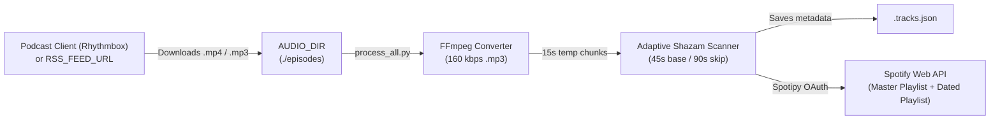

# 📻🎧 mp3-2-spotify

Automatically extract, recognize, and sync music tracks from long-form **MP3 / MP4 audio files**, **podcast episodes**, **radio shows**, or **DJ mixes** directly into your **Spotify playlists** — at **zero cost ($0)**.

Built around an **Adaptive Audio Scanner** powered by **FFmpeg**, **Shazam (`shazamio`)**, and the **Spotify Web API (`spotipy`)**, `mp3-2-spotify` handles host voiceovers, talk segments, rate-limits, and duplicate prevention out of the box.

---

## ✨ Key Features

* **🧠 Adaptive Audio Scanning**:
  * Extracts temporary **15-second** mono audio chunks via FFmpeg.
  * Advances by **45 seconds** during speech or silence so no song transition is missed.
  * Accelerates to **90-second steps** while a recognized track is still playing, cutting API requests in half compared to fixed-interval scanners.
* **🛡️ Built-in Rate-Limit & Timeout Protection**:
  * Disables `shazamio`'s default 20-attempt burst retry on HTTP `429` responses.
  * If Shazam temporarily rate-limits your IP, the scanner **holds the exact same timestamp** (`step = 0s`), waits for the 65-second sliding window to clear, and resumes without ever skipping a song.
* **🗜️ Automatic Audio Compression (`MP4/M4A` $\rightarrow$ `MP3`)**:
  * Optionally converts large `.mp4`/`.m4a` audio containers into **160 kbps MP3** files and deletes the originals, saving ~50% disk space before scanning.
* **🌐 Local Folder or Podcast RSS Feed Support**:
  * Point it to a local folder managed by your favorite podcast client (e.g., **Rhythmbox**, **gPodder**) **or** configure any standard `RSS_FEED_URL` to automatically download new episodes.
* **🎵 Dual Spotify Playlist Sync (Private by Default)**:
  1. **Cumulative Master Playlist** (e.g., `MB`): Appends only newly discovered tracks, automatically skipping songs already present in the playlist.
  2. **Per-Episode Dated Playlist** (e.g., `mb 2026-11-10`): Creates a dedicated playlist for each processed episode containing its full tracklist.
  * Enforces **private mode** (`public=False`) on newly created playlists.

---

## 🏗️ How It Works



---

## 📋 Prerequisites

1. **Python 3.10 – 3.12**
   *(Note: Python 3.13+ removed the standard `audioop` module required by `pydub`/`shazamio`; using Python 3.12 is recommended).*
2. **FFmpeg** installed on your system `PATH`:
   * **Ubuntu / Debian**:
     ```bash
     sudo apt update && sudo apt install ffmpeg
     ```
   * **macOS (Homebrew)**:
     ```bash
     brew install ffmpeg
     ```
   * **Windows (Winget)**:
     ```powershell
     winget install Gyan.FFmpeg
     ```
3. **A free Spotify account** and a **Spotify Developer App** (takes 1 minute to create).

---

## 🚀 Installation & Setup

### 1. Clone the repository
```bash
git clone https://github.com/paoloevan/mp3-2-spotify.git
cd mp3-2-spotify
```

### 2. Create a Python virtual environment & install dependencies
```bash
python3.12 -m venv venv
source venv/bin/activate
pip install -r requirements.txt
```

### 3. Create your Spotify Developer credentials
1. Go to the [Spotify Developer Dashboard](https://developer.spotify.com/dashboard) and log in.
2. Click **Create app**:
   * **App name**: `mp3-2-spotify`
   * **Redirect URI**: `http://127.0.0.1:8501`
   * Check **Web API** and save.
3. Open your app's **Settings** and copy the **Client ID** and **Client Secret**.

### 4. Configure your `.env` file
Copy the example configuration file and edit it with your preferences:
```bash
cp .env.example .env
nano .env
```

---

## ⚙️ Configuration Reference (`.env`)

| Variable | Default | Description |
| :--- | :--- | :--- |
| `SPOTIPY_CLIENT_ID` | *(required)* | Your Spotify Developer App Client ID. |
| `SPOTIPY_CLIENT_SECRET` | *(required)* | Your Spotify Developer App Client Secret. |
| `SPOTIPY_REDIRECT_URI` | `http://127.0.0.1:8501` | OAuth callback URI configured in your Spotify App. |
| `AUDIO_DIR` | `./episodes` | Directory containing the podcast/radio audio files to scan. |
| `RSS_FEED_URL` | *(empty)* | Optional Podcast RSS feed URL to auto-download new episodes. |
| `RSS_MAX_EPISODES` | `5` | Max number of recent episodes to check when downloading from RSS. |
| `COMPRESS_TO_MP3` | `true` | Automatically convert `.mp4`/`.m4a` files into `.mp3` before scanning. |
| `MP3_BITRATE` | `160k` | Target bitrate when converting to `.mp3`. |
| `DELETE_ORIGINAL_AFTER_CONVERT` | `true` | Delete the original `.mp4`/`.m4a` file after successful `.mp3` conversion. |
| `SPOTIFY_MAIN_PLAYLIST` | `MB` | Name, Spotify ID, or URL of your cumulative master playlist. |
| `SPOTIFY_CREATE_DATED_PLAYLIST` | `true` | Create an additional dedicated playlist for each processed episode. |
| `SPOTIFY_DATED_PLAYLIST_PREFIX` | `mb` | Prefix for the dated episode playlist (e.g., `mb 2026-11-10`). |
| `SPOTIFY_PLAYLIST_PUBLIC` | `false` | `false` keeps playlists private; `true` makes them public. |
| `SCAN_BASE_STEP` | `45` | Scanner step (seconds) when speech or silence is detected. |
| `SCAN_SKIP_STEP` | `90` | Scanner step (seconds) when the same track is still playing. |
| `SCAN_SAMPLE_LEN` | `15` | Duration (seconds) of each temporary audio snippet sent to Shazam. |
| `SCAN_REQUEST_DELAY` | `3.5` | Delay (seconds) between consecutive Shazam queries to avoid rate-limiting. |

---

## 💻 Usage

### 1. Automated Batch Processing (Recommended)
Run `process_all.py` to automatically:
1. Download new episodes from `RSS_FEED_URL` (if configured),
2. Convert any `.mp4`/`.m4a` files in `AUDIO_DIR` to 160 kbps `.mp3` and delete the originals,
3. Scan every episode that doesn't yet have a `.tracks.json` file,
4. Sync discovered songs to your cumulative Spotify playlist and create a private dated playlist:

```bash
./venv/bin/python process_all.py
```
*(On your very first run, a browser window will open once to authorize Spotify and save a permanent token in `.spotify_cache`).*

### 2. Scan the newest episode in `AUDIO_DIR` and sync to Spotify
```bash
./venv/bin/python mp3_to_spotify.py --spotify
```

### 3. Scan a specific audio file
```bash
./venv/bin/python mp3_to_spotify.py "/path/to/episode.mp3" --spotify
```

### 4. Override target playlist or dated playlist behavior via CLI
```bash
# Sync to a custom cumulative playlist name or URL
./venv/bin/python mp3_to_spotify.py --spotify --playlist "My Radio Discoveries"

# Sync only to the main playlist without creating a dated episode playlist
./venv/bin/python mp3_to_spotify.py --spotify --no-dated-playlist
```

### 5. Extract tracklist only (JSON + console output, no Spotify sync)
```bash
./venv/bin/python mp3_to_spotify.py "/path/to/episode.mp3"
```
This generates `/path/to/episode.tracks.json` containing timestamps, artist, title, Shazam URL, and Spotify URI metadata.

### 6. Sync to Spotify from an existing `.tracks.json` file
If you already scanned an episode and want to push its `.tracks.json` to Spotify without re-scanning the audio:
```bash
./venv/bin/python mp3_to_spotify.py --from-json "/path/to/episode.tracks.json"
```

---

## 🔌 Integrating with Podcast Clients or RSS Bridges

You can feed `mp3-2-spotify` in two ways:

1. **Desktop Podcast Client (e.g., Rhythmbox, gPodder)**:
   * Subscribe to your favorite music podcast or radio show RSS feed in your podcast client.
   * Set `AUDIO_DIR` in `.env` to the folder where your client downloads episodes (e.g., `~/Music/MyPodcast`).
   * Run `./venv/bin/python process_all.py` whenever new episodes are downloaded.
2. **Direct RSS Feed (Built-in Downloader)**:
   * Set `RSS_FEED_URL="https://example.com/podcast/feed.xml"` in `.env` (works with standard podcast feeds as well as self-hosted RSS bridges like [`frammenti/raiplaysoundrss`](https://github.com/frammenti/raiplaysoundrss)).
   * `process_all.py` will automatically fetch the newest episodes into `AUDIO_DIR` before scanning.

---

## ⚖️ Disclaimer & Fair Use

This project is open-source and intended strictly for **personal and educational use**:
* **No copyrighted audio is hosted or distributed** by this repository. All audio files remain local to the user's machine and are excluded via `.gitignore`.
* Only non-copyrightable metadata (song titles, artist names, and timestamps) is extracted to build personal playlists via the official Spotify Web API.
* Please respect the Terms of Service of your audio providers and keep `SCAN_REQUEST_DELAY` at conservative values (`>= 3.0s`) to avoid overloading recognition endpoints.

---

## 📄 License

Released under the [MIT License](LICENSE).
